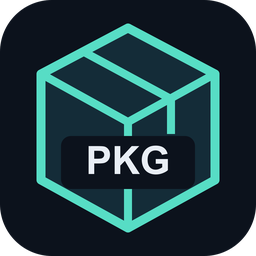
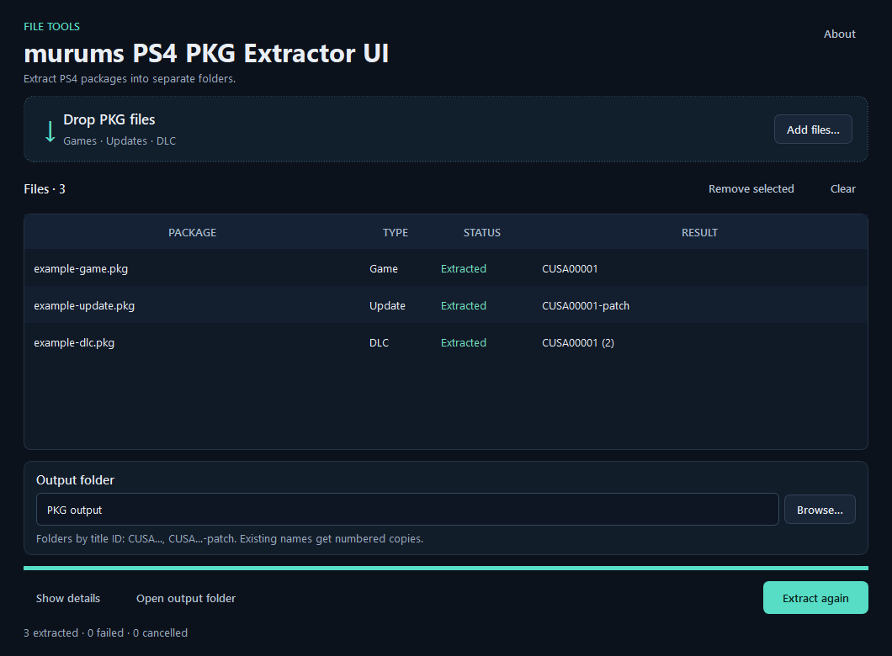

#  &nbsp; murums PS4 PKG Extractor UI

[All downloads](https://github.com/murums04/ps4-pkg-extractor-ui/releases/latest) · [Report a bug](https://github.com/murums04/ps4-pkg-extractor-ui/issues)

Extract PS4 PKG files into separate **title-ID folders**. Queue games, updates and DLC; keep existing results with numbered alternatives.

Community GUI by **murums**, based on the [AzaharPlus/shadPS4Plus PKG extractor](https://github.com/AzaharPlus/shadPS4Plus).



<sub>Screenshot uses synthetic metadata-only packages.</sub>

## Download

**Version 0.1.0** · [SHA-256 checksums](https://github.com/murums04/ps4-pkg-extractor-ui/releases/latest/download/SHA256SUMS.txt)

| Platform | Installer | Portable |
| --- | --- | --- |
| Windows x64 | [Setup EXE](https://github.com/murums04/ps4-pkg-extractor-ui/releases/latest/download/ps4-pkg-extractor-ui-0.1.0-windows-x64-setup.exe) | [ZIP](https://github.com/murums04/ps4-pkg-extractor-ui/releases/latest/download/ps4-pkg-extractor-ui-0.1.0-windows-x64-portable.zip) |
| macOS · Apple Silicon | [DMG](https://github.com/murums04/ps4-pkg-extractor-ui/releases/latest/download/ps4-pkg-extractor-ui-0.1.0-macos-arm64.dmg) | [ZIP](https://github.com/murums04/ps4-pkg-extractor-ui/releases/latest/download/ps4-pkg-extractor-ui-0.1.0-macos-arm64-portable.zip) |
| macOS · Intel | [DMG](https://github.com/murums04/ps4-pkg-extractor-ui/releases/latest/download/ps4-pkg-extractor-ui-0.1.0-macos-x64.dmg) | [ZIP](https://github.com/murums04/ps4-pkg-extractor-ui/releases/latest/download/ps4-pkg-extractor-ui-0.1.0-macos-x64-portable.zip) |
| Linux x64 | [DEB](https://github.com/murums04/ps4-pkg-extractor-ui/releases/latest/download/ps4-pkg-extractor-ui-0.1.0-linux-x64.deb) | [tar.gz](https://github.com/murums04/ps4-pkg-extractor-ui/releases/latest/download/ps4-pkg-extractor-ui-0.1.0-linux-x64-portable.tar.gz) |

Choose an installer for normal use. All app packages include Python, Qt and the extractor. GitHub's **Code → Download ZIP** contains source code.

- **Windows:** run Setup for a per-user installation, shortcuts and uninstaller. For portable use, extract the whole ZIP and run `PS4 PKG Extractor UI.exe`; keep `_internal` beside it.
- **macOS:** open the DMG and drag the app into Applications, or extract the app ZIP. Choose Apple Silicon or Intel for your Mac. Requires macOS 15 or newer.
- **Linux:** install the DEB on Ubuntu 22.04 or newer, or extract the whole tar.gz and run `ps4-pkg-extractor-ui`. The DEB installs required system libraries.

Windows executables are unsigned; macOS apps are ad-hoc signed and not notarized. Windows requires version 10 1903 or newer; Windows 10 itself has not been tested. See [supported systems and build details](docs/building.md).

## Use

1. Drop `.pkg` files or select **Add files**.
2. Choose an **Output folder**; it defaults to the first input's folder.
3. Select **Extract PKG**, then **Open output folder**. Use **Show details** for errors and paths.

Each PKG gets its own folder directly inside the selected output folder:

```text
Output/
├── CUSA74774/
├── CUSA74774-patch/
└── CUSA74774 (2)/
```

Games use their title ID; updates add `-patch`. Existing names get numbered alternatives. DLC retains its entitlement subdirectory inside a separate CUSA folder. No extra folder uses the PKG filename.

Inputs stay read-only. **Extract again** creates another copy. Cancel or close to discard the current partial output and keep completed results. Failed files do not stop the queue.

## Updates & privacy

The app processes your PKG files locally. It checks this repository's latest stable GitHub release at startup and when you click **Check now** in **About**. You install updates manually. No telemetry or file uploads.

## Details

Builds the shadPS4Plus **1.1** engine from pinned sources with a correction for incomplete encrypted metadata blocks. The UI adds bounded metadata checks, cancellation, separate outputs and detection of reported engine errors.

Tests cover synthetic packages, known encrypted metadata and local Windows extraction of a real game, update and license-only DLC. License-only DLC may omit the total-size field; the app still checks entry bounds and content metadata. Some upstream file-write and decompression checks remain limited, so a completed job does not certify the integrity of arbitrary game contents. Use packages you trust.

See [format limits and test coverage](docs/verification.md), [build/CLI instructions](docs/building.md) and [release notes](docs/release-notes.md).

**UI: GPL-3.0-only · Extractor: GPL-2.0-or-later.** Keep [LICENSE](LICENSE), [third-party notices](THIRD_PARTY_NOTICES.md) and corresponding source when redistributing. Dependency licenses are in `licenses/`.

<sub><a href="https://ko-fi.com/murums">Ko-fi</a></sub>
